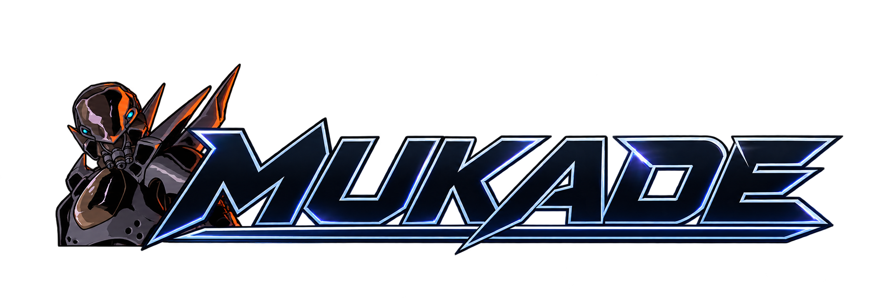

<h1 align="center">
  
</h1>

<p align="center"><strong>Continue a coding-agent session in a different harness.</strong></p>

<p align="center">
  <a href="#quickstart">Quickstart</a> ·
  <a href="#supported-harnesses">Harnesses</a> ·
  <a href="#terminal-ui">Terminal UI</a> ·
  <a href="#local-mcp-chat">MCP chat</a> ·
  <a href="#ecosystem">Ecosystem</a> ·
  <a href="#contributing">Contributing</a>
</p>

<p align="center">
  <a href="LICENSE"></a>
  <a href="#rust-library"></a>
</p>

---

Start a task in Claude Code, then pick it up in Pi, Codex, or another supported harness. Mukade reads the saved history and creates a **native session** in the destination. The original session stays intact. The receipt gives you the new session ID, the command to resume it, and a manifest of what was converted or left behind.

- **Browse and resume** sessions from multiple harnesses in one terminal UI.
- **Export and import** sessions as JSON for backups or handoffs to another machine.
- **Connect running agents** in a local MCP room so they can exchange messages and follow each other's work.
- **Embed the handoff** in your own tool through the Rust library.

## Quickstart

Build from source with [Rust](https://rustup.rs/) and Git.

```sh
git clone https://github.com/acaprino/mukade.git
cd mukade
cargo build --release --locked --workspace
```

The build produces `mukade` and `mukade-tui` in `target/release/`, with `.exe` on Windows. Add that directory to your `PATH` or run the binaries by their paths.

**Continue a Claude Code session in Pi.** Replace `SESSION_ID` with an ID from `list` and use the paths to your own stores.

```text
mukade list claude_code --root "/path/to/.claude"
mukade hop claude_code SESSION_ID pi --root "/path/to/.claude" --dest-root "/path/to/.pi/agent" --manifest hop.json
```

Run the receipt's `resume` command from the project folder. Pass `--cwd` when the destination uses a different checkout. With the default compaction settings, the hop converts the selected history locally. The destination harness uses its own model and credentials when you resume.

[Full usage guide](docs/usage.md) · [Store configuration](docs/usage.md#7-stores-and-executables) · [Reading the receipt](docs/usage.md#4-reading-the-receipt-and-the-manifest)

## Supported harnesses

All six adapters can list and export sessions, and can act as both the source and destination of a hop. `mukade harnesses` shows which installations and stores Mukade can see on your machine.

| Harness | CLI ID | Session support | Chat connection |
| --- | --- | --- | --- |
|  **[Claude Code](docs/harnesses/claude-code.md)** | `claude_code` | Read and write · detects running sessions · carries every branch of its tree | CLI · MCP live-tested |
|  **[Codex CLI](docs/harnesses/codex.md)** | `codex` | Read and write · carries every branch of a thread (redone pages, rollbacks) | CLI · MCP live-tested |
|  **[OpenCode](docs/harnesses/opencode.md)** | `opencode` | Read and write · imports via OpenCode | CLI · MCP setup available |
|  **[Pi](docs/harnesses/pi.md)** | `pi` | Read and write · carries every branch of its tree | CLI · MCP setup available |
|  **[Hermes Agent](docs/harnesses/hermes-agent.md)** | `hermes` | Read and write · imported tool history travels as text | CLI |
|  **[DeepSeek Harness](docs/harnesses/deepseek-harness.md)** | `deepseek_harness` | Read and write · native `dsh` session logs | CLI |

Hermes import and readback were [verified on v0.23.1](docs/verification/2026-11-12-hermes-writer-live.md). A DeepSeek session was imported and resumed with [`dsh` 0.2.2-rc.1](docs/verification/2026-11-12-dsh-writer-live.md). Source-model summaries and destination-native compaction are available for Claude Code, Codex, OpenCode, and Pi. The Codex summary path was tested against a mock provider. [Compaction options](docs/usage.md#5-choose-what-travels) · [Summary verification](docs/verification/source-model-summary-live.md)

## What travels with a session

Mukade reads the transcript in the source harness's native order, converts messages and tool history, checks the destination's format, then writes a new session. Tool calls the destination cannot represent can travel as text. Provider-specific reasoning follows the selected reasoning policy and the destination's replay support.

Use `--children` to include supported subagent sessions, `--interrupted drop` to leave out unfinished work, or `--compaction portable` to carry an existing summary and its remaining turns. The manifest records conversions, omissions, and the fingerprint of the source.

[History and compaction](docs/usage.md#5-choose-what-travels) · [Tool conversion tables](docs/tool-conversion-tables.md) · [Interchange specification](docs/session-interchange-spec.md)

## Terminal UI

```sh
cargo run -p mukade-tui
```

Browse stores and transcripts, then press **`R`** to resume, **`h`** to hop, **`e`** to export, or **`i`** to import. Use `--scan <directory>` to discover additional installations. [TUI guide](mukade-tui/README.md)

## Local MCP chat

Start a background server and open a room for running agents. Peers can exchange messages, observers can follow a reduced transcript, and a lead can assign work to workers. Agents can join and check for messages through MCP or the CLI.

```sh
mukade chat start
mukade chat open --name design
mukade chat tools
```

Use `mukade chat connect <harness> --dry-run` to preview MCP setup for Claude Code, Codex, OpenCode, or Pi. Claude Code and Codex have exchanged messages through the server in live tests. [Connection instructions](docs/usage.md#local-chat-between-harness-instances) · [Live test record](docs/verification/2026-11-12-chat-live.md)

## Rust library

```sh
cargo add mukade --git https://github.com/acaprino/mukade.git
```

```rust
use mukade::{HarnessId, HopRequest, hop};
use mukade::hop::SessionRef;
use mukade::roots::StoreRoots;

fn main() -> Result<(), mukade::HopError> {
    let request = HopRequest::new(
        SessionRef::id(HarnessId::ClaudeCode, "SESSION_ID"),
        HarnessId::Pi,
        StoreRoots::from_env(),
    );
    let receipt = hop(&request)?;
    println!("{}", receipt.dest_id);
    println!("{:?}", receipt.resume_command);
    println!("{}", receipt.manifest);
    Ok(())
}
```

The example reads the source and destination store paths from the harnesses' environment variables. The crate also exposes `export`, `import`, and `hop_into` for hosts that manage their own stores. [Host options](docs/usage.md#6-host-and-automation-options) · [Rust API specification](docs/session-interchange-spec.md#12-rust-surface)

## Ecosystem

| Project | Role |
| --- | --- |
| **[Shinatama](https://github.com/acaprino/shinatama)** | Desktop workspace for running coding agents in tiled terminals. Mukade started here as a session-interchange library, and Shinatama embeds Mukade's session readers. [Session integration record](https://github.com/acaprino/shinatama/blob/master/docs/mukade-handover.md) |
| **[Muro](https://github.com/acaprino/acaprinoprivate)** | Builds skill packages and session policies for multiple agent hosts. Muro packages the capabilities an agent can use, and Mukade moves the session history between harnesses. |

Both companion repositories are private on GitHub.

## Contributing

Open a [GitHub issue](https://github.com/acaprino/mukade/issues) with the harness, version, command, and a small sanitized fixture if the issue involves a transcript. The [adapter architecture](docs/architecture.md#adding-a-harness) describes where readers, writers, and tests belong.

```sh
cargo test --locked --workspace
```

[Technical documentation](docs/README.md#technical-reference) · [Verification records](docs/README.md#verification-records)

## License

[MIT](LICENSE). The [harness marks](docs/assets/branding/harnesses/README.md) belong to their respective owners.
